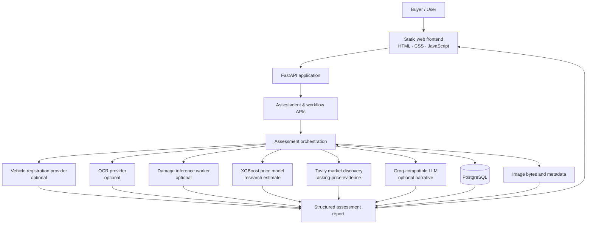
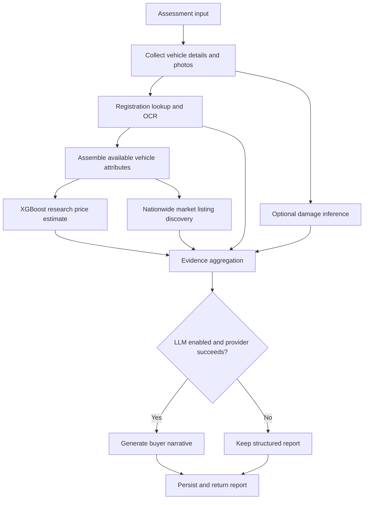

# Vehicle IQ

**AI-powered used-car intelligence and buyer-assistance platform for the Indian automotive market.**

[](https://vehicle-iq-frontend.vercel.app/)
[](https://www.python.org/)
[](https://fastapi.tiangolo.com/)
[](https://www.postgresql.org/)
[]()

**Live application:** https://vehicle-iq-frontend.vercel.app/  
**Source code:** https://github.com/anshh-py/Vehicle-IQ

Vehicle IQ brings together vehicle registration data, uploaded photographs, OCR, optional damage inference, a research XGBoost price model, nationwide used-car market discovery, and an optional Groq-powered narrative. It turns the available evidence into a structured assessment to help a buyer investigate a used vehicle.

> **Project scope:** Vehicle IQ is a portfolio and research project. It is not a certified vehicle inspection, a guaranteed valuation service, or a substitute for an independent mechanic's inspection.

---

## Contents

- [What it does](#what-it-does)
- [Architecture](#architecture)
- [Assessment workflow](#assessment-workflow)
- [Key features](#key-features)
- [Technology stack](#technology-stack)
- [Repository structure](#repository-structure)
- [Getting started](#getting-started)
- [Environment configuration](#environment-configuration)
- [API overview](#api-overview)
- [Testing](#testing)
- [Limitations](#limitations)
- [Future work](#future-work)

## What it does

A user creates an assessment, provides available vehicle and seller details, and uploads vehicle photographs. The backend runs the configured assessment stages and builds a report from the evidence each stage actually returns.

| Capability | Role in the assessment |
|---|---|
| Registration lookup | Retrieves provider-reported vehicle information when configured |
| OCR | Extracts text candidates from uploaded images; OCR is not treated as identity proof |
| Damage inference | Runs the configured image-inference worker when available |
| Price estimation | Produces a research estimate using the tracked XGBoost model |
| Market discovery | Finds and validates relevant nationwide advertised listings through Tavily |
| AI narrative | Optionally converts structured evidence into a buyer-oriented explanation using a Groq-compatible LLM |
| Report persistence | Stores assessment and report data in PostgreSQL |

The report distinguishes user inputs, provider-reported facts, OCR output, model estimates, market advertisements, and AI-generated interpretation. Missing or failed integrations should be represented as unavailable or failed—not silently treated as successful evidence.

## Architecture

### High-level system architecture



### Report evidence flow



Optional providers can be disabled, unconfigured, unavailable, or return incomplete data. The workflow is designed to preserve the structured assessment when an optional stage cannot complete.

## Assessment workflow

1. **Create an assessment** — save registration number, vehicle details, asking price, and other available inputs.
2. **Upload photographs** — validate image type and size, then persist image bytes and metadata.
3. **Identify the vehicle** — use OCR text as a registration candidate and query the configured registration provider when enabled.
4. **Run optional inspection stages** — execute OCR and damage inference where configured and supported by the image/provider.
5. **Estimate a price** — assemble the required features and run the XGBoost research model when all required inputs are available.
6. **Research the market** — use Tavily to discover nationwide listings, validate relevance, remove duplicates and outliers, and calculate a range only when sufficient comparable evidence exists.
7. **Generate the buyer narrative** — call the configured Groq-compatible LLM when enabled and available.
8. **Persist the report** — save the structured report and return the result to the frontend.

## Key features

### 1. Vehicle identification and registration lookup

- Captures a registration number through the assessment workflow.
- Supports OCR-assisted registration candidate extraction.
- Includes an optional provider-backed registration lookup adapter.
- Keeps provider-reported values separate from user-entered and OCR-derived values.
- Supports a manual registration-number path when OCR cannot confidently read a plate.

Provider responses are not independently verified by Vehicle IQ. The report should preserve their provenance.

### 2. Image upload and OCR

- Supports multiple JPEG, PNG, and WebP images per assessment.
- Validates image format and upload size.
- Stores image bytes in PostgreSQL `BYTEA` columns with separate metadata.
- Uses a configurable OCR provider abstraction.
- Records OCR output and unreadable/failed states separately from registration lookup results.

OCR provider modes present in the code include `huggingface_gradio`, `paddleocr_local`, `hybrid`, and a legacy direct-service option.

### 3. Optional damage inspection

- Uses an isolated, checkpoint-driven inference worker.
- Reports outcomes such as findings, no findings, unavailable, or failed.
- Keeps model-generated observations distinct from a confirmed physical inspection.

Damage inference is optional and should not be interpreted as a comprehensive mechanical or body inspection.

### 4. XGBoost used-car price estimate

- Loads the tracked model artifact at `models/vehicle_iq_price_model.joblib`.
- Uses a dedicated pricing provider to assemble features and run inference.
- Requires the vehicle attributes expected by the model.
- Returns an unavailable result when required inputs are missing rather than inventing a price.

The model is explicitly a **research candidate**, not an independently production-validated valuation model.

### 5. Nationwide used-car market research

- Uses the Tavily adapter in `app/market/tavily.py`.
- Searches nationwide rather than restricting comparable discovery to the vehicle's RTO city.
- Validates listing relevance and price data, removes duplicates, and filters unsuitable results.
- Reports a market range only when there is sufficient comparable evidence.
- Treats listing prices as advertised asking prices—not completed transaction prices.

The repository includes `MARKET_DATA_COLLECTION.md`, which documents the project's market-data collection approach. The code does not claim permission to scrape marketplaces that prohibit automated collection.

### 6. Optional Groq-powered buyer narrative

- Uses an OpenAI-compatible chat-completions client configured through environment variables.
- Builds the prompt from structured assessment evidence.
- Separates provider data, user inputs, OCR output, model estimates, market evidence, damage findings, and AI interpretation.
- Preserves the structured report if the LLM is disabled or its request fails.

The AI narrative is an explanation of available evidence, not an independent source of vehicle facts.

## Technology stack

| Area | Technologies |
|---|---|
| Frontend | HTML, CSS, vanilla JavaScript |
| Backend | Python, FastAPI, Uvicorn |
| API/data validation | Pydantic, Pydantic Settings |
| Database and ORM | PostgreSQL, SQLAlchemy, Alembic |
| Machine learning | XGBoost, scikit-learn, pandas, joblib |
| LLM integration | Groq-compatible API, HTTPX, structured JSON output |
| Market research | Tavily search adapter and listing validation |
| Image processing | Pillow, PaddleOCR, Hugging Face Gradio integration |
| Testing | pytest |
| Deployment | Vercel frontend, Render backend, PostgreSQL hosted separately |

**Note:** Redis is not currently integrated in the checked-in implementation. LangSmith is also not currently integrated in this repository. LangSearch appears as an auxiliary discovery helper; Tavily is the market-discovery adapter used by the assessment report workflow.

## Repository structure

```text
vehicle-iq/
├── app/
│   ├── api/
│   │   └── v1/
│   │       ├── assessments.py
│   │       ├── damage.py
│   │       ├── images.py
│   │       ├── ocr.py
│   │       ├── pricing.py
│   │       ├── reports.py
│   │       ├── vehicle_lookup.py
│   │       └── workflow.py
│   ├── core/
│   │   ├── config.py
│   │   ├── observability.py
│   │   └── security.py
│   ├── db/
│   │   ├── models.py
│   │   └── session.py
│   ├── damage/
│   ├── llm/
│   ├── market/
│   ├── ocr/
│   ├── pricing/
│   ├── schemas/
│   ├── storage/
│   ├── vehicle_lookup/
│   └── main.py
├── frontend/
│   ├── app.js
│   ├── assets/
│   ├── index.html
│   └── styles.css
├── models/
│   └── vehicle_iq_price_model.joblib
├── scripts/
├── tests/
├── alembic/
├── .env.example
├── DEPLOYMENT.md
├── MARKET_DATA_COLLECTION.md
├── requirements.txt
└── README.md
```

Important modules:

- `app/main.py` — FastAPI application entry point and frontend routing.
- `app/api/v1/workflow.py` — assessment workflow orchestration.
- `app/api/v1/reports.py` — report assembly and optional narrative generation.
- `app/db/models.py` — SQLAlchemy persistence models.
- `app/pricing/provider.py` — XGBoost model loading and inference.
- `app/market/tavily.py` — Tavily-backed market discovery.
- `app/llm/client.py` and `app/llm/report.py` — LLM client and report prompt logic.
- `frontend/` — static browser interface.

## Getting started

### Prerequisites

- Python version compatible with `.python-version`.
- PostgreSQL database.
- Git.
- Optional API credentials for the external providers you want to enable.

### 1. Clone the repository

```powershell
git clone https://github.com/anshh-py/Vehicle-IQ.git
cd Vehicle-IQ
```

### 2. Create and activate a virtual environment

```powershell
py -m venv .venv
.\.venv\Scripts\Activate.ps1
python -m pip install --upgrade pip
pip install -r requirements.txt
```

### 3. Configure environment variables

```powershell
Copy-Item .env.example .env
notepad .env
```

Set `DATABASE_URL` to a PostgreSQL database you can access. Add provider credentials only for integrations you intend to use.

### 4. Run database migrations

After configuring the database connection:

```powershell
python -m alembic upgrade head
```

### 5. Start the application

```powershell
python -m uvicorn app.main:app --host 127.0.0.1 --port 8081 --reload
```

Open the local application:

- http://127.0.0.1:8081/
- http://127.0.0.1:8081/dashboard
- http://127.0.0.1:8081/inspect

The frontend is served by FastAPI. The checked-in frontend does not require a separate Node.js or npm build step.

### 6. Optional: provision local PaddleOCR assets

If using the local PaddleOCR provider:

```powershell
python scripts/provision_paddleocr_models.py
```

See `DEPLOYMENT.md` for deployment-specific details.

## Environment configuration

The application loads settings from the root `.env` file through `app/core/config.py`. `.env.example` is the starting point; keep real credentials out of Git.

| Variable | Purpose |
|---|---|
| `DATABASE_URL` | PostgreSQL connection string |
| `APP_ENV` | Application environment and production safety behavior |
| `API_ACCESS_TOKEN` | Bearer token for protected API access; required in production according to the app configuration |
| `API_RATE_LIMIT_PER_MINUTE` | API rate limit |
| `MAX_IMAGE_UPLOAD_BYTES` | Maximum allowed image upload size |
| `MAX_EXTERNAL_RESPONSE_BYTES` | Maximum accepted external response size |
| `TAVILY_API_KEY` | Enables Tavily market discovery |
| `TAVILY_TIMEOUT_SECONDS` | Tavily request timeout |
| `TAVILY_RESULT_LIMIT` | Tavily search result limit |
| `LLM_ENABLED` | Enables or disables AI narrative generation |
| `LLM_API_KEY` | Groq-compatible API key |
| `LLM_BASE_URL` | LLM API base URL; Groq-compatible default is configured in the app |
| `LLM_MODEL` | Model identifier sent to the configured LLM endpoint |
| `LLM_TIMEOUT_SECONDS` | LLM request timeout |
| `LANGSEARCH_API_KEY` | Optional auxiliary LangSearch discovery helper |
| `OCR_SERVICE_PROVIDER` | OCR provider selection |
| `OCR_GRADIO_SPACE_URL` | Gradio OCR endpoint |
| `OCR_GRADIO_MODE` | Gradio OCR mode |
| `OCR_TIMEOUT_SECONDS` | OCR request timeout |
| `OCR_SERVICE_URL` | Legacy direct OCR service URL |
| `OCR_PADDLE_DETECTION_MODEL_DIR` | Local PaddleOCR detection model directory |
| `OCR_PADDLE_RECOGNITION_MODEL_DIR` | Local PaddleOCR recognition model directory |
| `DAMAGE_INFERENCE_PYTHON` | Python executable for isolated damage inference |
| `DAMAGE_CHECKPOINT_PATH` | Damage model checkpoint path |
| `DAMAGE_INFERENCE_TIMEOUT_SECONDS` | Damage inference timeout |
| `PRICE_MODEL_PATH` | Optional override for the XGBoost model artifact |
| `VEHICLE_LOOKUP_ENABLED` | Enables the optional registration provider |
| `VEHICLE_LOOKUP_BASE_URL` | Registration provider base URL |
| `VEHICLE_LOOKUP_TIMEOUT_SECONDS` | Registration provider timeout |
| `CHALLAN_LOOKUP_ENABLED` | Enables optional challan lookup |
| `CHALLAN_LOOKUP_BASE_URL` | Challan provider base URL |
| `CHALLAN_LOOKUP_TIMEOUT_SECONDS` | Challan provider timeout |
| `FASTAG_LOOKUP_ENABLED` | Enables optional FASTag lookup |
| `FASTAG_LOOKUP_BASE_URL` | FASTag provider base URL |
| `FASTAG_LOOKUP_TIMEOUT_SECONDS` | FASTag provider timeout |

Some variables are only relevant to optional integrations. Check `.env.example` and `app/core/config.py` for the exact defaults and current configuration behavior. Do not assume a provider is active just because its variable is present.

## API overview

The primary API is versioned under `/api/v1`.

### Assessment lifecycle

| Method | Endpoint | Purpose |
|---|---|---|
| `POST` | `/api/v1/assessments` | Create an assessment |
| `GET` | `/api/v1/assessments` | List assessments |
| `GET` | `/api/v1/assessments/{assessment_id}` | Retrieve an assessment |
| `PATCH` | `/api/v1/assessments/{assessment_id}` | Update assessment data |

### Images and OCR

| Method | Endpoint | Purpose |
|---|---|---|
| `POST` | `/api/v1/assessments/{assessment_id}/images` | Upload an image |
| `GET` | `/api/v1/assessments/{assessment_id}/images` | List assessment images |
| `GET` | `/api/v1/assessments/{assessment_id}/images/{image_id}/content` | Retrieve image content |
| `POST` | `/api/v1/assessments/{assessment_id}/images/{image_id}/ocr` | Run OCR on an image |

### Vehicle lookup and services

| Method | Endpoint | Purpose |
|---|---|---|
| `POST` | `/api/v1/assessments/{assessment_id}/registration-number` | Save a manual registration number |
| `POST` | `/api/v1/assessments/{assessment_id}/ocr-results/{ocr_result_id}/registration-lookup` | Run registration lookup from an OCR result |
| `POST` | `/api/v1/assessments/{assessment_id}/ocr-results/{ocr_result_id}/vehicle-services` | Query optional challan and FASTag providers |

### Pricing, workflow, and reports

| Method | Endpoint | Purpose |
|---|---|---|
| `POST` | `/api/v1/assessments/{assessment_id}/price-estimates` | Generate a research price estimate |
| `POST` | `/api/v1/assessments/{assessment_id}/workflow` | Run the assessment workflow |
| `POST` | `/api/v1/assessments/{assessment_id}/report` | Generate a report snapshot |
| `GET` | `/api/v1/assessments/{assessment_id}/report` | Retrieve the stored report |

The workflow endpoint coordinates the configured stages and records their actual outcomes. Optional stages may be unavailable depending on credentials, provider health, input completeness, or model availability.

## Testing

Run the test suite from the repository root:

```powershell
pytest
```

The repository includes tests covering assessment APIs, workflow orchestration, image handling, OCR, pricing, market listing validation, damage inference, LLM report generation, and security behavior.

Some tests require external credentials or optional local model assets. A passing mocked-provider test does not prove that a live third-party integration is currently available.

## Limitations

- The XGBoost model is a research candidate and has not been independently validated as a production valuation model.
- Market results are advertised listing prices, not confirmed sale prices.
- The number of valid comparables can be insufficient to calculate a defensible market range.
- Registration-provider data is provider-reported and is not independently verified.
- OCR may fail or return ambiguous text.
- Damage inference may be unavailable, inconclusive, or fail.
- Groq narrative generation depends on configuration and provider availability.
- Challan, FASTag, registration, OCR, market research, and LLM integrations depend on external services and credentials.
- The project does not replace a physical inspection, service-history verification, or a mechanic's assessment.

## Future work

- Improve the coverage and quality of validated nationwide market comparables.
- Expand evaluation of the price model against independent datasets.
- Improve evidence-level confidence and provenance in the report UI.
- Add more integration tests against controlled provider responses.
- Improve reliability and observability for optional external services.
- Add polished, representative screenshots and a short end-to-end demo.

---

## Project links

- **Live application:** https://vehicle-iq-frontend.vercel.app/
- **GitHub repository:** https://github.com/anshh-py/Vehicle-IQ

**Vehicle IQ** — an evidence-first used-car assessment workflow built with Python, FastAPI, PostgreSQL, machine learning, and LLM integration.
